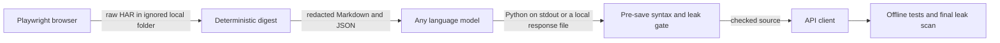

# Website to API

Turn browser network traffic into a redacted API digest, then use any language model to produce a checked Python client.

## Why I built it

I kept running into sites where the useful data was already available to the browser, but the path to it was hidden behind the interface. This project records those calls and reduces them to the small set needed for a client. I built the redaction and leak checks into the workflow because a useful client is not worth exposing a session cookie.

Use this only on public data or systems you are authorized to access. Prefer an official API when one exists.

## How it works



- `capture.py` records fetch, XHR, JSON, and other browser traffic to `.tmp/website-to-api/`.
- `digest.py` filters assets and common telemetry, groups similar paths, and keeps representative request and response samples.
- The digest inventories sensitive request and response headers, cookies, query parameters, and JSON or form fields before it writes output.
- `generate_client.py` accepts any model command that reads a prompt from stdin and returns Python on stdout.
- `save_client.py` provides the same gate for a response copied from a chat interface or produced through an API.
- `verify_no_secret_leak.py` compares publishable files with captured values in plain, URL-encoded, JSON-escaped, and Base64 forms.

## Guardrails

- Raw captures, browser profiles, secret vaults, and model drafts live under ignored folders. They are never model inputs.
- Secret discovery happens before endpoint filtering. A credential copied into an unusual header or response body is still available to the final scrubber.
- The secret vault is written with owner-only permissions. Verification reports secret names, never values.
- Model output stays in memory until it parses as Python and passes the same captured-value check. Existing clients are not overwritten unless `--force` is explicit.
- Capture slugs are validated, URLs must use HTTP or HTTPS, and existing captures require `--force` before replacement.
- Persistent browser profiles require an explicit account-risk acknowledgement. Use a dedicated authorized test account, never a primary personal account.
- The client prompt requires 20 second request timeouts, HTTP error handling, argument validation, and a one second delay between paginated calls.
- Private web endpoints can change without notice. Re-capture, regenerate, and rerun tests when a client fails.

## Quick start

The demo is offline and needs no browser, account, or API key. Its fictional HAR contains fake authentication values on purpose so the redaction can be proved.

```bash
python -m venv .venv
source .venv/bin/activate
pip install -r requirements.txt
python scripts/run_demo.py
pytest -q
```

For a real public or authorized site, install the Playwright browser once, then capture and digest the calls:

```bash
python -m playwright install chromium
python scripts/capture.py \
  --url "https://public.example/search" \
  --goal "search public records by keyword" \
  --slug public-search \
  --mode watch
python scripts/digest.py --slug public-search
python scripts/verify_no_secret_leak.py --slug public-search
```

To use a model CLI, pass any command with a stdin to stdout contract. The command is split into arguments and run without a shell.

```bash
python scripts/generate_client.py \
  --slug public-search \
  --model-command "your-model-cli"
```

For a chat interface or your own model API, build the same self-contained prompt, give it to the model, put the response in the ignored `.tmp` folder, and run the save gate:

```bash
python scripts/build_prompt.py --slug public-search > .tmp/public-search-prompt.txt
python scripts/save_client.py \
  --slug public-search \
  --input .tmp/public-search-model-response.txt
python scripts/verify_no_secret_leak.py --slug public-search
```

This boundary has no model SDK or provider dependency. Model cost controls belong in the provider or local runtime you choose. The included runner adds a timeout and output-size cap but does not claim to enforce a provider's billing limit.

## Example output

Running `python scripts/run_demo.py` against the fictional Northwind Dental fixture produces:

```text
kept 1 data endpoint from 3 requests
{
  "endpoint": "POST https://api.northwind-dental.example/v1/clinics/{id}/plans",
  "redacted_headers": [
    "authorization",
    "cookie",
    "x-api-key"
  ],
  "query": {
    "region": "central",
    "api_key": "<REDACTED:QUERY_API_KEY>"
  }
}
CLEAN 11 secret names checked across 2 files
```

The public [Hacker News Algolia example](examples/hn-algolia-search/) shows the resulting client shape. Its tests inject fictional responses, confirm pagination and request construction, and make no network calls.

## Tech

- Python 3.10 or newer
- Playwright for browser capture and HAR recording
- Requests for generated and example clients
- Pytest for offline tests
- HAR 1.2, JSON, Markdown, and Mermaid

## Repository layout

```text
scripts/                         capture, digest, model adapter, and leak gate
prompts/write-api-client.md      provider-neutral client-writing contract
examples/hn-algolia-search/     public worked client
tests/fixtures/fictional.har    offline redaction proof
tests/                           digest, leak, model gate, and client tests
```

## License

MIT. Copyright (c) 2026 Christian Terrone.

